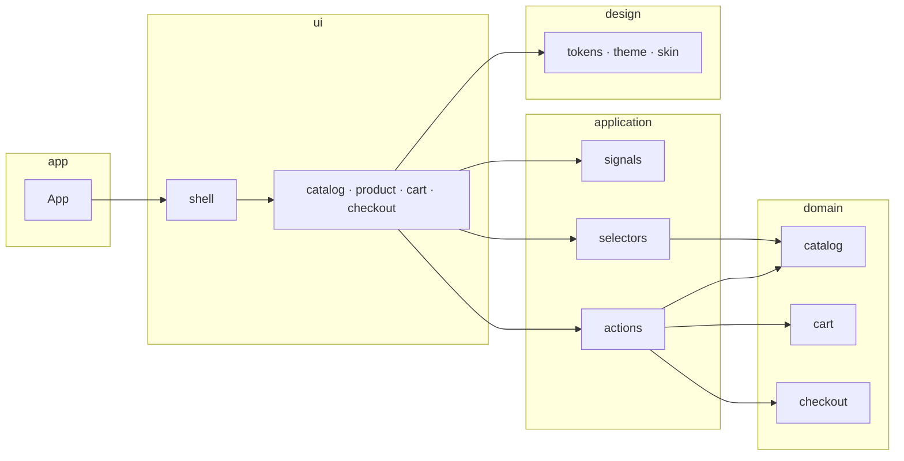

<div align="center">

```
 ███████╗██╗██████╗  ██████╗     ███████╗████████╗ ██████╗ ██████╗ ███████╗
 ██╔════╝██║██╔══██╗██╔═══██╗    ██╔════╝╚══██╔══╝██╔═══██╗██╔══██╗██╔════╝
 █████╗  ██║██████╔╝██║   ██║    ███████╗   ██║   ██║   ██║██████╔╝█████╗
 ██╔══╝  ██║██╔══██╗██║   ██║    ╚════██║   ██║   ██║   ██║██╔══██╗██╔══╝
 ██║     ██║██████╔╝╚██████╔╝    ███████║   ██║   ╚██████╔╝██║  ██║███████╗
 ╚═╝     ╚═╝╚═════╝  ╚═════╝     ╚══════╝   ╚═╝    ╚═════╝ ╚═╝  ╚═╝╚══════╝
```

# Fibo Store

**Studio merch for builders.** Wear · Desk · Print.

A full mini-commerce built only with [FiboUI](https://www.npmjs.com/package/fiboui) fluent builders —  
layout, theme, motion, and signals as method calls. **No JSX in the product UI.**

[](./tsconfig.json)
[](https://www.npmjs.com/package/fiboui)
[](https://vitejs.dev)
[](#)

<br />

```bash
npm install && npm run dev
# → http://127.0.0.1:5180
```

**Live:** [fiboui-store.vercel.app](https://fiboui-store.vercel.app)

</div>

---

## What you get

| Flow | Screens |
| :--- | :--- |
| **Browse** | Hero banner · search · category tiles · filter toolbar · product grid / bento |
| **Buy** | Product detail · size & qty · bag · free-shipping meter |
| **Checkout** | Shipping · form signals · order success |

Palette locked to the store skin: **ink** `#0a0a0a` · **pink** `#ff2d8a` · **lime** `#c8ff00` · **chalk** `#ffffff`.

---

## Architecture

Clean layers. Dependencies point **inward** — UI never leaks into domain.



```text
src/
├── app/                 # Composition root — mount only
├── domain/              # Pure types + catalog data (no UI)
│   ├── catalog/         #   products, money, categories
│   ├── cart/            #   line types
│   └── checkout/        #   screen + ship types
├── application/         # Signals · actions · selectors
├── design/              # Tokens · theme · retail CSS skin
└── ui/
    ├── shell/           # StoreApp · header · footer · stage
    ├── catalog/         # Banner · bar · grid · cards · art
    ├── product/         # PDP
    ├── cart/            # Bag
    ├── checkout/        # Checkout + success
    └── shared/          # Press helpers
```

| Layer | Owns | Never owns |
| :--- | :--- | :--- |
| **domain** | Product data, money helpers, cart/checkout types | Signals, builders, CSS |
| **application** | `signal()` state, mutations, derived lists/totals | Layout, theme tokens |
| **design** | Brand tokens, `extendTheme(noirTheme)`, shop skin | Business rules |
| **ui** | Screen builders | Product catalog math |

---

## Taste of the code

```ts
Button('Add to bag')
  .variant('raw')
  .height(48)
  .bg(pink)
  .color(chalk)
  .fontWeight(800)
  .letterSpacing('0.12em')
  .textTransform('uppercase')
  .onPress(() => addToCart())
```

Reactive tree without remounting inputs:

```ts
Box()
  .bindSignal(cart)
  .bindSignal(screen)
  .children(() => [cartChip()])
```

---

## Quick start

```bash
git clone https://github.com/felipeoliveiradev/fibo-store.git
cd fibo-store
npm install
npm run dev
```

| Script | What it does |
| :--- | :--- |
| `npm run dev` | Vite on **5180** |
| `npm run typecheck` | `tsc --noEmit` |
| `npm run build` | Typecheck + production bundle |
| `npm run preview` | Serve `dist/` |

---

## Stack

<p>
  
  
  
  
</p>

Built as a standalone extract of the FiboUI marketing site shop — same UX, proper boundaries.

---

<div align="center">

**Wear the return.**

`© Fibo Store · powered by FiboUI`

</div>
